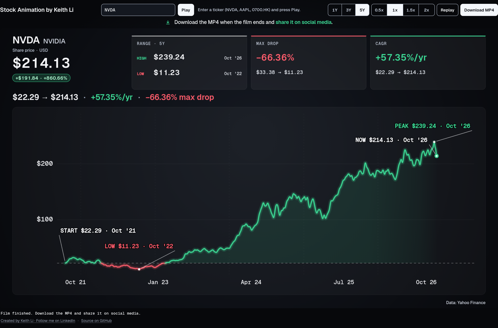

# Stock Animation by Keith Li

[English](README.md) · 繁體中文

選一隻股票，就能得到一段 30 秒的股價短片，即刻可以分享。

Stock Animation 把一隻股票的每日收市價變成一段動畫走勢圖。線條由你所選時段的第一個收市價開始，一路畫到最新收市價，在關鍵時刻放慢，最後用一句話總結整段走勢。你可以先在瀏覽器觀看，再下載成 MP4，分享到社交媒體。

**[立即製作短片](https://stock-animation.keith-li.workers.dev)**。免費，毋須註冊，打開網頁時會先播放 NVDA，讓你先看看效果。



## 製作短片

1. 在頂部輸入股票代號，按 Enter。美股直接輸入代號（`NVDA`、`AAPL`、`BRK.B`）。港股輸入 `.HK` 代號（`0700.HK`），只輸入數字如 `700` 亦會當作港股處理。
2. 選擇時段：**1Y**、**3Y** 或 **5Y**，預設為五年。
3. 觀看短片。播放及暫停按鈕在短片下方，旁邊是重播及速度選項（**0.5x**、**1x**、**1.5x**、**2x**）。
4. 播放完畢後，按 **Download MP4** 下載，隨意分享。

播放速度只影響觀看，下載的檔案永遠是完整 30 秒、1920×1080，不論你選擇哪個速度。

## 短片內容

短片由時段內第一個收市價開始，線條即時開始畫。線條推進時，會標示起點、最高收市價及最低收市價，各附價格及日期。當股價經過重要時刻，例如下跌 20% 或以上、其後的回升，或者單日最大升幅及跌幅，短片會標示出來，並在最急劇的一刻放慢，讓你看清楚。

三張卡片全程顯示：時段內的最高及最低價、由高位到其後低位的最大跌幅，以及由第一個收市價到最新收市價的年均增長率（CAGR）。最後三秒，一句話總結整個故事：由哪裏開始、現在在哪裏、每年增長多快，以及期間最大的跌幅。

## 須知

- **股價來源。** 所有數字來自 [Yahoo Finance](https://finance.yahoo.com/) 的每日收市價，已按拆股調整，短片角落亦註明資料來自 Yahoo。股息沒有計算在內，所以短片顯示的是股價本身，並非總回報。
- **數據有多新。** 短片以該市場時區（香港或紐約）最近一個已完成的交易日作結。
- **支援市場。** 暫時只支援美股及港股。
- **下載。** 影片由你的瀏覽器在你自己的電腦上製作，不會上傳任何東西。新版 Chrome、Edge 及 Safari 會儲存為 MP4，不支援 MP4 的瀏覽器則會儲存為 WebM。
- **人人都快。** 每隻股票的價格會存放在共用快取，第二個人查同一隻股票時即時就有，下次收市後才會再向 Yahoo 取數。
- **並非投資建議。** 短片只顯示股價過去的表現，並不建議買入或賣出任何股票。

## 自行運行

Stock Animation 以 [MIT 授權](LICENSE)開源。要運行自己的版本，需要 Node.js 22：

```bash
git clone https://github.com/keithligh/stock-animation.git
cd stock-animation
npm install
npm run dev
```

然後打開 [localhost:5173](http://localhost:5173)。如果你在此基礎上開發，請保留版權聲明並註明原作。

## 作者

Stock Animation 由 Keith Li 製作。歡迎在 [LinkedIn](https://www.linkedin.com/in/keithlihk) 及 [GitHub](https://github.com/keithligh) 找到他。
